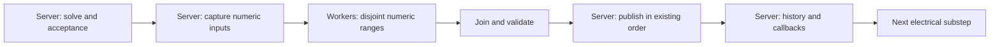

# Batching-enabled profiling and worker-thread plan

Historical profiling snapshot. The subsequent implementation and measurements
are in [Packed result processing](PACKED_RESULTS.md). That prototype was slower
and has been [reverted](PACKED_ROLLBACK.md); the earlier batching runtime remains.

This investigation continues `dev/experimental-plain-wire-batching` at
`011fd2d`. It profiles the unchanged `0.2.7-experimental.plainwire.2` runtime,
with both plain-wire and CEE property batching enabled. It changes diagnostic
tools and this plan, not simulation code or save formats. All launches use
separate copies of the preserved 14,650-node benchmark save.

## Measured costs and the 20 TPS gap

The first threading candidate is numeric result processing after a solve.
Native solving alone is too small to close this run's gap. Even the combined
result-processing work will need additional savings elsewhere to meet the
p95 target; average 20 TPS and reliable 50 ms ticks are different thresholds.

| Fresh attempt | Instrumentation | Mean tick ms | p95 tick ms | TPS |
| --- | --- | ---: | ---: | ---: |
| `profile-batched-clean-01` | None | 58.10 | 74.93 | 17.17 |
| `profile-batched-timers-01` | Sampled phase timers | 59.02 | 76.89 | 16.90 |
| `profile-batched-jfr-01` | Sampled timers + JFR | 55.97 | 71.11 | 17.76 |

The clean control needs 8.10 ms/tick of mean savings to reach a 50 ms budget.
Its server thread used 57.71 ms CPU per tick, allocated 11.86 MiB per tick and
incurred 59 ms of reported GC time across the approximately 120-second window.
This is primarily CPU work. Allocation still costs CPU and memory bandwidth
even when GC pauses are short.

The preceding enabled samples were 51.51 and 55.15 ms/tick. The unchanged jar
does not make JVM row/hook ordering, compilation or host conditions identical.
Use the entire observed range, not the best historical sample. The difference
between the clean and timer process is not a calibrated instrumentation cost.

The timer-only run captured 112 complete 16-substep traces: 102 ordinary samples
and 10 forced edit samples. Its population-weighted sampled mean is 58.32 ms.
The following exclusive scopes sum to that mean; the final small-scopes row
includes preparation, hook boundaries, publication and scheduling bookkeeping.

| Work | Estimated mean ms/tick | Threading implication |
| --- | ---: | --- |
| Wire power + CEE results/history + terminal samples | 16.23 | Main candidate after extracting pure numeric work |
| Other work inside Minecraft's tick | 12.28 | Requires stack attribution; cannot assume it is movable |
| CEE preparation, including synchronization | 8.25 | World/device/graph access; retain server ownership |
| Native terminal preparation | 5.90 | World/owner/geometry validation; reuse only with valid invalidation rules |
| Native solve, including its callbacks | 4.75 | Serial dependency; native ownership redesign required |
| RHS construction | 2.99 | Shared output buffer and ordered accumulation |
| CEE gameplay commit | 2.63 | Device callbacks, events, heating and synchronization |
| CEE result finalization | 1.22 | Some arithmetic, but also validation/publication |
| Remaining electrical scopes | 4.07 | Several smaller serial operations |

The 16.23 ms group comprises **5.24 ms wire power**, **5.45 ms CEE result/history**
and **5.53 ms terminal sampling**. These are whole method/loop scopes, including
guards and callbacks. They are not 16.23 ms of proven parallel arithmetic.

### Scaling bounds, not implemented speedups

For each sampled tick, the model is
`new tick = old tick - group cost * eligible fraction * (1 - 1/workers) + overhead`.
Percentiles are calculated from the projected ticks, not by subtracting one
phase's p95 from the tick p95. The same sample weights are retained.

| Assumption for the 16.23 ms group | Projected mean ms | Projected p95 ms |
| --- | ---: | ---: |
| 2 workers, 75% eligible, 1 ms extra serial cost/tick | 53.23 | 68.00 |
| 4 workers, 75% eligible, 1 ms extra serial cost/tick | 50.19 | 63.76 |
| 4 workers, 100% eligible, 1 ms extra serial cost/tick | 47.15 | 59.76 |

One millisecond is an assumption covering the entire tick's additional
snapshot/dispatch/join/publication work, not a measured overhead. Four workers
at 75% eligibility would save about 8.13 ms/tick in this model: enough to put
today's clean mean near 50 ms, with very little margin. The tail still misses.

Even the impossible model of deleting all native-solve time leaves a 53.57 ms
sampled mean. Deleting all wire-power time alone leaves 53.07 ms. Deleting the
entire 16.23 ms group leaves sampled p95 at 53.65 ms. Thus this profile does not
support a claim that threading any one existing loop will deliver the practical
target. Improving preparation and the rest of the tick remains part of the plan.

### What JFR identified

The 120-second recording contains 8,749 Java execution samples on the server
thread, plus 140 server-thread native-method samples. No server sample stack
was truncated. The native samples point to `NativeMNA.singleTick` (134), RHS
buffer flushing (5) and RHS clearing (1). Their count is not a native CPU-time
percentage; native timing comes from the phase timers.

The second instrumented process supports the same main targets: 14.48 ms in
the three post-solve passes, 14.03 ms in CEE/terminal preparation and 4.52 ms
in native solving. Its weighted sampled mean is 54.78 ms, versus 58.32 ms in
the timer-only process. It also recorded 23.9 seconds of aggregate compilation
time during the window, versus 0.8-1.2 seconds in the other two processes.
Keep its timing diagnostic; this is not evidence that enabling JFR improves
performance or a reason to replace the clean control.

The Java stacks locate specific work:

* Wire batching: 327 samples in `PlainWireBatch.select` and 562 in
  `postMicroTick`. Of the selection samples, 244 include direct-buffer voltage
  reads. Snapshot/validation is a substantial part of this scope, supporting
  the need to measure the serial portion before choosing a worker count.
* CEE preparation: 801 samples include `StableDescription.update`; another
  328 include `Terminals.refresh`. The existing stable-graph path still checks
  owners, descriptors and chunks. It is not already a free cached lookup.
* Terminal preparation: all 1,100 samples include `NativeApiReadings.snapshot`,
  with 434 including owner/geometry lookup. Persistent mappings and reuse with
  correct invalidation are candidates for reducing the serial preparation cost.
* Outside the electrical schedule: 777 samples are in wire temperature
  updates, including 493 ambient-temperature/biome lookups; 455 are in wire
  entity queries and 84 in contact bookkeeping. Block-entity ticks account for
  434 samples, and chunk ticking/tracking for 368. These counts are separate
  categories of Java samples, not additive millisecond estimates. The pinned
  wire code confirms that temperature updates mutate synchronized entity data
  and can burn/remove wires, while contact processing can change circuit state.
  Keep those commits and world queries on the server thread.

The thread counter measured about 25.57 GB of allocations in the JFR run's
stable ticks. After excluding the initial allocation sample, JFR estimates
25.60 GB: about 6.59 GB in terminal preparation, 5.89 GB in CEE preparation,
4.75 GB in wire queries/contact bookkeeping and 3.09 GB in gameplay commit.
Objects include maps, arrays, terminal bounding boxes, vectors, node/property
descriptors and query iterators. This reinforces reducing repeated preparation
and query work alongside the worker experiment. GC pause events total 95.91 ms,
so pause time alone does not explain the missing tick budget.

The initial server allocation sample had a 103.96 GB weight, already much
larger than the whole measured window's thread-counter total. It is treated as
boundary-contaminated, preserved separately and excluded from site attribution;
it must not be reported as 104 GB of `ChunkPos` allocation during this run.

The next sequence is therefore: **packed serial result processing, then two/four
workers over the proven numeric portion; alongside that, reduce repeated
preparation and wire world-query work.** A native solver replacement is a later
experiment. This profile concerns stable ticks; it does not establish a chunk
loading speedup or a safe asynchronous chunk-loading design.

## Measurement method

Three fresh processes use the same frozen inputs: clean timing, sampled phase
timers, and sampled timers plus Java Flight Recorder (JFR). Scalar verification
is disabled in all three. The earlier bitwise verification run is correctness
evidence only; its costs are excluded from this profile.

Each process restores 953 chunks and 1,050 storage devices, warms up for 120
seconds, and measures for 120 seconds. The yard remains one solver network with
14,650 electrical nodes, 20,637 connections and 14,925 matrix rows. Every stable
tick must retain 16 solves, no matrix rebuilds, no independent CEE solves and
no rejected solves. Topology fingerprints, normal save/shutdown and original
save hashes are checked. No full suite or graphical acceptance is run.

The server uses Java 21.0.12, NeoForge 21.1.231, PG 0.6.2, CEE 1.1.4, Create
6.0.10-280, an 8 GiB heap, the normal 60-second watchdog and server-thread CPU
mask `fff000`. The local host is a Ryzen 9 7900X, with the High performance
power plan. This is not a production-server capacity claim.

Runtime SHA-256:
`8f59be1043aaaf47c33561f3327ef5f52b5ca01eac8aef7039bd1066cb849aa2`.
Loaded guarded native SHA-256:
`1c8a4e7cbae743bd5a1553d4222d437b881367b0777987574cafb0249a6b033c`.
The frozen helper remains
`cb67f3bbe08568992e1664558a3dc503c876be8cad5badf7872efbd763e3224e`.
The compiled sources and all three frozen artifact hashes match the preceding
74 focused checks; those passes remain their original evidence, not new runs.

The timer helper samples one tick in 20 and additionally samples the tick after
each voltage edit. The analysis weights these two groups by their observed
population counts so the extra edit samples do not dominate the means.
Nested timer scopes are separated before adding costs. Sampled p95 estimates
have much less resolution than whole-run p95. JFR records the stable window,
including benchmark observation outside `tickServer`; observer work is labelled
separately. Java and native-method sample counts use different periods and are
never combined into one CPU percentage. JFR does not resolve native C stacks.

## Thread ownership boundaries

The code provides several hard constraints:

* [ServerElectricalSchedule](../../src/main/java/org/cha0scollective/wwpg/bridge/ServerElectricalSchedule.java)
  advances all worlds through each substep before the next. This yard is one
  connected solver network, so parallelizing independent networks offers no
  work division here. Splitting the connected circuit requires a different
  numerical algorithm and error/convergence investigation.
* [WorldBridge](../../src/main/java/org/cha0scollective/wwpg/bridge/WorldBridge.java)
  consumes accepted voltages, updates branch currents and dynamic CEE history,
  then uses those results in the next substep. The 16 substeps cannot run
  concurrently. CEE windings can share a rotor; dynamic callbacks are not
  independent just because their wires are distinct.
* Preparation and commit read chunks, block entities, native owners and device
  geometry; they mutate graph/stamp state and publish events, heating and client
  data. Moving these methods wholesale to a worker is not safe.
* The pinned PG native source stores `JNIEnv*` in `solver_init` and reuses it
  for callbacks, exceptions and global references. The JNI entry to
  `singleTick` does not replace it. The safety patch also uses that retained
  pointer. JNI interface pointers belong to their current thread, per the
  [Java 21 JNI specification](https://docs.oracle.com/en/java/javase/21/docs/specs/jni/design.html#jni-interface-functions-and-pointers).
  Therefore a server-created solver cannot simply be submitted to an executor.
  A solver actor would need explicit creation, callback, buffer and destruction
  ownership; a worker followed immediately by a join does not shorten the
  serial critical path by itself.
* The [native build](../../tools/native/CMakeLists.txt) sets `USE_THREAD OFF`
  for the linked OpenBLAS and uses the pinned serial SuperLU interface. Changing
  an environment variable cannot enable threading in this binary. A different
  solver/library build is a separate experiment, including native failure and
  lifecycle checks.

The native source was inspected at the exact
[pinned PG commit](https://github.com/patryk3211/PowerGrid/blob/0938be067fb71f311b3e5fd6c5f7cdaed722e241/native/src/powergridNative/c/solver.c),
with the repository's [guarded patches](../../tools/native/pg-safety.patch).

## Proposed first threading experiment

Start with a packed representation of the numeric work after each solve. Its
three candidate consumers are wire power aggregation, CEE result sampling and
native terminal sampling. First run that representation serially to measure
snapshot and publication costs independently of threading.



1. Capture accepted voltages into owned primitive arrays, with a generation
   identifying the network, topology, tick and substep. Snapshot conductance,
   source/coupling currents, row mappings and prior accumulators at their
   current ordering boundaries. Never pass live native buffers, world objects,
   node getters, property callbacks or mutable PG collections to workers.
2. Partition by wire/branch/frame so each output slot has one owner. Preserve
   each wire's `(V * G) * V`, addition and division order. Preserve signed
   current, simultaneous winding-current sums before RMS, clamping, signed
   zero and rejection semantics. No unordered floating-point reduction is
   needed for independent wire/frame outputs.
3. Keep native solving, arbitrary hooks, extension callbacks and shared CEE
   dynamic state on the server thread. Start with exact built-in classes and
   no custom adapters. If callback order prevents fusing consumers, retain
   their boundaries or fall back; never move work across an unproven callback.
4. Use a bounded persistent pool with coarse ranges, measuring two and four
   workers. Avoid a future/task per wire. The budget must include every
   dispatch, join, snapshot, validation and ordered publication across all
   16 substeps. Measure memory bandwidth and contention as well as CPU use.
5. Validate the entire staged result before publishing. A failure, cancellation
   or generation mismatch must not publish a partial result. Drain in-flight
   jobs before reusing snapshots or unloading their owner; workers must never
   outlive the data they reference. Preserve the existing network rejection,
   restoration and unavailable-result rules.

The key distinction is the fraction of these loops that can actually become
independent numeric work. Their full measured time is an upper bound, not a
promise of parallel speedup. Snapshot sharing and fewer repeated node lookups
may help the serial version before workers are introduced.
Reprofile that serial version before projecting worker gains: do not add a
packing speedup to a threading estimate derived from the same original cost.

For the separate preparation/query work, first measure reuse of terminal row
mappings, geometry and CEE descriptors under explicit owner/topology generation
checks. Investigate repeated ambient-temperature and empty contact queries
without changing their physical effects or entity update order. Entity movement,
replacement, chunk unload and topology changes must invalidate any reused data.
Generic entity ticks, heating, electrocution and device callbacks are not worker
tasks merely because the benchmark has no player standing near the wires.

## Focused gates for that future prototype

Keep each variant opt-in on this branch with another frozen input set. Compare
the current serial path, the packed serial path, two workers and four workers
on new copies of the same benchmark. Run small powered differential checks on
both Java and native backends, including live conductance/source edits, signed
and exceptional values, reconnect, rejection, unload/restoration and worker
failure/cancellation. Verify per-wire and per-frame numerical equivalence and
all 16 substeps before timing with verification disabled.

Choose a worker variant only if its complete tick cost, including preparation
and publication, improves consistently. The current practical target remains
at least 19.9 measured TPS with p95 at or below 50 ms. A short focused pass does
not establish sustained capacity or release readiness. No worker implementation
or additional acceptance run is part of this profiling task.

## Reproduce and evidence

Use Java 21 and Python from the experimental worktree. Every invocation needs
a fresh attempt name; existing attempts must remain intact.

```text
python tools/experimental/plain_wire_benchmark.py --reference-root <main-checkout> --name profile-batched-clean-new --runtime local/frozen/prototype-02c/wwpg-0.2.7-experimental.plainwire.2.jar --batch --property-batch
python tools/experimental/plain_wire_benchmark.py --reference-root <main-checkout> --name profile-batched-timers-new --runtime local/frozen/prototype-02c/wwpg-0.2.7-experimental.plainwire.2.jar --batch --property-batch --detailed
python tools/experimental/plain_wire_benchmark.py --reference-root <main-checkout> --name profile-batched-jfr-new --runtime local/frozen/prototype-02c/wwpg-0.2.7-experimental.plainwire.2.jar --batch --property-batch --detailed --substep-jfr
python tools/experimental/summarize_profile.py --attempts profile-batched-clean-new profile-batched-timers-new profile-batched-jfr-new --output local/new-profile-results.json
```

The summary command uses the frozen Java installation and `JfrCompact.java`
to stream CPU/allocation and selected GC/monitor fields with a 512 MiB heap cap.
It retains every recorded stack frame without recursively exporting loader
metadata. The compact export, command, reader-source hash and input/output
hashes stay beside the recording; existing exports are verified, not overwritten.
Use a new output path for a new report.

The first analysis attempt used JFR's verbose JSON, expanding the 2.3 MB
recording to 6.9 GB. Its in-memory reader was stopped. The original recording
is unchanged, and that derived export is retained as a gzip file with a verified
round-trip hash. The compact reader produced a 38.3 MB export in the successful
analysis. This was an analysis retry, not another game/benchmark run.

The separate [profile result index](batched-profile-results.json) records raw
evidence hashes, clean and instrumented measurements, phase costs, thread
counters, JFR sample attribution and hypothetical scaling models. The previous
[property batching report](PROPERTY_WIRE_BATCHING.md) and its result index stay
preserved.
