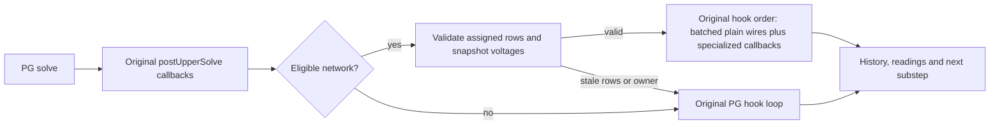

# Experimental plain-wire batching

This is an isolated research branch based on WWPG 0.2.7. It is not a release
candidate, an accepted save format change, or part of normal development.
Use disposable copies of saves. No production save was opened for these checks.

Branch: `dev/experimental-plain-wire-batching`.
Base: `cca3c09b36059cc44ec04cc2f03eea449936a460`.
Prototype: `0.2.7-experimental.plainwire.1`.

## What this prototype does

The first experiment batches the power aggregation of exact PG `ElectricWire`
and `TransmissionLine` instances. All 16 electrical substeps still execute in
order on the server thread. It does not introduce worker threads, reduce solve
frequency, change the solver, or change saved data.

After each solve and all `postUpperSolve` callbacks, an eligible network takes
one primitive voltage snapshot of its assigned endpoints. A cached plan then
visits hooks in the original PG set iteration order. Ordinary wires use the
snapshot and their current conductance. Each contribution is added immediately
as `aggregatePower + ((voltage * conductance) * voltage) / tickCount`.
Ground polarity, floating-point operation order, finite-value masking and the
existing scalar fallback for nonpositive/nonfinite conductance are retained.

The exact PG `CurrentSourceWire`, `SwitchedWire`, `CRSeriesWire` and WWPG
`PropertyCurrentSourceWire` classes retain their existing power callbacks.
Their inherited aggregation callbacks are read-only apart from their own power
accumulators. The batch supports exact PG `FloatingNode`/`OwnedFloatingNode`,
`ElectricalNetwork`/`GraphedElectricalNetwork`, and Java/Native MNA classes.

An unknown hook, subclass, custom node, or tracked leaf disables the entire
network's batch. The original hook set and its iteration remain untouched in
that case; a custom callback can still observe preceding power updates, mutate
state, throw, or release the solver. Paused, dirty, unconverged and released
networks also use the existing path. Single-substep execution is unchanged.

Membership edits, dirty matrices, stale-wire pruning, leaf changes, reindexing,
network cleanup/backend changes, wire ownership and endpoint flips invalidate
the plan. Assigned rows and owners are checked again before every snapshot.
Native state views are local to that snapshot and never cross a substep or
callback boundary. Plans remain attached to their network, without a static
registry retaining unloaded networks.

Two JVM properties explicitly enable the experiment:

```text
-Dwwpg.experimental.plainWireBatch=true
-Dwwpg.experimental.plainWireBatch.verify=true
```

The second property additionally compares every batched power value and proposed
aggregate against the original scalar formula, bit for bit. It is for correctness
checks; leave it off for performance comparisons. Both properties default off.
There is no in-world toggle and no shipping configuration change.



## Frozen inputs and isolation

The worktree is `local/x27w` under the main checkout. Its `local/` directory
contains frozen jars, independent server directories, copied saves and evidence.
The main checkout remains on its original branch. No release file, tag, native
binary, original benchmark world or captured historical run is replaced.

The experiment uses Java 21.0.12, NeoForge 21.1.231, Create 6.0.10-280,
CEE 1.1.4, PG 0.6.2 and Architectury 13.0.8. CEE 1.1.4 is explicitly selected
for both baseline and prototype; the repository's compile default is not used
as a substitute for this runtime selection. The unchanged guarded PG DLL is
verified from the actual jar contents and server logs.

Published baseline jar SHA-256:
`6c1060b17f14df765188a60da154b723705947503a813508a53f62013e625053`.
Frozen benchmark helper SHA-256:
`cb67f3bbe08568992e1664558a3dc503c876be8cad5badf7872efbd763e3224e`.

The original 10,000-tier MIXED save actually contains 14,650 electrical nodes,
20,637 connections, 1,050 storage devices and 953 chunks. It is first copied to
`local/inputs/reference`, with per-file hashes. Every attempt receives a new copy
of that reference. The original and reference are verified before/after use.
Transient `session.lock` and the `level.dat_old` backup are excluded from the
copy inventory; the actual world data and metadata remain hash-checked.
The yard has one solver network and 14,925 matrix rows.

## Focused protocol

No full headless suite or graphical client is launched. All tests use separate
worlds and frozen jars. The focused correctness selections are:

* `wwpg_wire_power` on Native and Java, including four new batch fixtures and
  the five existing scalar/restoration fixtures, with bitwise verification on.
* `wwpg_unload,wwpg_solver_safety` on Native and Java, with the same flags.

The large-save control uses an 8 GiB heap, a fixed server-thread CPU mask
`fff000`, ordinary 60-second watchdog, all 16 solves, 120 seconds of warmup and
120 seconds of stable measurement. Source voltage edits remain enabled. There
is no GameTest companion in that process. Detailed runs sample every 20 ticks
and preserve per-substep timings; clean runs have detailed timers off.

A passing control must restore all 953 chunks, retain the original topology,
execute 16 solves per stable tick without matrix rebuilds, report zero rejected
solves and zero CEE worker solves, retain 1,050 storage devices and save/shut down
normally. Prototype runs additionally require proof that the 10,368 eligible
plain wires in the large yard actually used the batch. These short controls
do not establish sustained capacity or release acceptance.

### Reproduce in this worktree

Use Java 21 and a working Python interpreter. Build once, then copy the runtime,
GameTest companion and CEE jar to a fresh frozen directory and record their
SHA-256 values in `inputs.json`; the first captured set is
`local/frozen/prototype-01/inputs.json`. Never rebuild over frozen inputs.

```text
gradlew.bat jar gameTestJar -x test --offline --no-daemon -I tools/experimental/plain-wire.gradle -PexperimentalCee=<CEE-1.1.4-jar>
python tools/experimental/focused_checks.py --inputs local/frozen/prototype-01/inputs.json --backend NATIVE --name wire-native-new
python tools/experimental/focused_checks.py --inputs local/frozen/prototype-01/inputs.json --backend JAVA --name wire-java-new
python tools/experimental/focused_checks.py --inputs local/frozen/prototype-01/inputs.json --backend NATIVE --selection lifecycle --name lifecycle-native-new
python tools/experimental/focused_checks.py --inputs local/frozen/prototype-01/inputs.json --backend JAVA --selection lifecycle --name lifecycle-java-new
python tools/experimental/plain_wire_benchmark.py --reference-root <main-checkout> --name baseline-clean-new
python tools/experimental/plain_wire_benchmark.py --reference-root <main-checkout> --name candidate-clean-new --runtime local/frozen/prototype-01/wwpg-0.2.7-experimental.plainwire.1.jar --batch
```

Add `--detailed` only to a separate diagnostic control. Add `--verify-batch` to
a separate correctness control, and do not treat its timing as clean performance.
Use a new attempt name each time. The helper, 0.2.7 baseline, reference world and
existing loader library profile are local research inputs, not release downloads.
Their paths are explicit in the runner. Running the server may require local IPC
access beyond a restrictive shell sandbox.

The small benchmark support files are preserved copies from the existing local
research tooling: `tools/benchmark/bench.py`, `tools/benchmark/process_metrics.py`,
and `local/benchmarks/gameplay-dev101-reprofile-20261024/world_save_evidence.py` in
the main checkout. The helper's source/resources are separately frozen beside
its jar. No helper source is patched between comparison runs.

## Recorded results — 2026-11-08

The frozen prototype runtime SHA-256 is
`d7fa86604815690a94b98a1c91473af5ecfeb312b8c415b6b9e0be7be833a317`.
The jar comparison found five added batch classes and changes only to mixin
registration, the shutdown counter report and version metadata. All native
resources and all other existing runtime classes are byte-identical to 0.2.7.

| Focused selection | Native | Java |
| --- | ---: | ---: |
| Wire power, including new batch fixtures | 9/9 | 9/9 |
| Unload and solver safety | 11/11 | 11/11 |

All 40 checks passed with batch and bitwise verification enabled. New checks
explicitly require actual batch contributions; custom callbacks/nodes and tracked
leaves explicitly require the scalar path. Frozen jars and compiled-source
hashes were verified unchanged after the checks.

| Clean 120-second control | Mean ms/tick | p95 ms/tick | TPS | Restoration seconds |
| --- | ---: | ---: | ---: | ---: |
| Published 0.2.7 | 60.16 | 71.78 | 16.58 | 108.63 |
| Same prototype jar, batching disabled | 58.94 | 67.22 | 16.93 | 103.90 |
| Prototype, batching enabled | 52.10 | 60.69 | 19.14 | 102.40 |

The first clean comparison shows an 8.06 ms/tick (13.4%) reduction in mean tick
time. The 20 TPS target is still unmet, including its 50 ms p95 condition. The
prototype control completed 2,295 measured ticks with no rejected solves or
stable-phase matrix rebuilds. Its execution counters recorded 789,949,698 batched
contributions over the complete attempt, including warmup, and a largest batch
of 10,368 plain wires (4,425 ordinary wires and 5,943 transmission lines).

Disabling batching in the same frozen jar gave 58.94 ms/tick. Relative to that
control, enabling batching reduced mean tick time by 6.84 ms (11.6%). This
supports a useful benefit, while remaining a small sample of fresh processes.
Restoration was 103.90 seconds with batching disabled versus 102.40 enabled;
the evidence does not establish a chunk-loading improvement.

The separate `candidate-verified-detailed-01` control passed with bitwise
verification enabled: **732,280,005 batched contributions** matched scalar power
and the resulting aggregate over the complete attempt, including warmup. It
completed 2,123 measured ticks with zero rejected solves; all 117 sampled tick
traces contained exactly 16 accepted substeps, with no missing loop phases or
trace overflows. The same graph, 1,050 storage devices, normal save/shutdown and
unchanged original reference were verified. Its 56.30 ms/tick includes scalar
cross-checks and detailed timers and is not a clean speed measurement.

The separate detailed 0.2.7 control averaged 57.16 ms/tick and 17.45 TPS. It is
diagnostic evidence, not the clean baseline. The first attempted baseline launch
failed before measurement because the shell sandbox denied Java loopback IPC;
that failed attempt is retained as `baseline-clean-01` and is never counted as
a pass. The successful fresh baseline is `baseline-clean-02`.

The machine-readable [results and evidence index](plain-wire-results.json)
records the raw-run paths and hashes, frozen input hashes, validation outcomes,
timings, startup stages and graph fingerprints.

## Interpretation and next decision

The fresh detailed 0.2.7 baseline attributes about 12.15 ms/tick to power
aggregation and 4.81 ms/tick to the native solve. Those are observations from a
short instrumented run, not universal costs. The clean and detailed baseline
means already differ by about 3 ms, so a small single-run improvement needs an
additional matched control before attributing it to this change.
The captured matrix row order and hook iteration order differ between fresh JVM
processes, even with the same save and CPU mask. Each order remains stable within
its measured run. This is a source of variation, not a controlled variable.

This experiment tests whether extracting compact, reusable numerical data is
worthwhile before introducing threads. It does not itself optimize chunk I/O,
graph construction or chunk attachment. Loading timings are recorded to detect
regressions; a different startup time alone does not establish a loading gain.

Future threading requires a separate design for snapshot ownership, invalidation,
deterministic result application, shutdown/cancellation and JNI thread ownership.
The 14,650-node yard is one electrical island, so assigning whole networks to
workers would not split its dominant job. Keep the experimental branch isolated
until evidence supports the next prototype; do not merge it into a release lane.

The next narrow candidate is batching the 9,443 exact CEE property-source power
callbacks, which still re-read voltages already present in this prototype's
snapshot. Measure that as a separate change with the same scalar verification.
Do not fold arbitrary dynamic wires into the fast path. After that, profile the
remaining device preparation, history and readings work before choosing a
worker-thread boundary. Chunk loading needs a separate experiment targeting its
measured loading and graph-construction stages.
